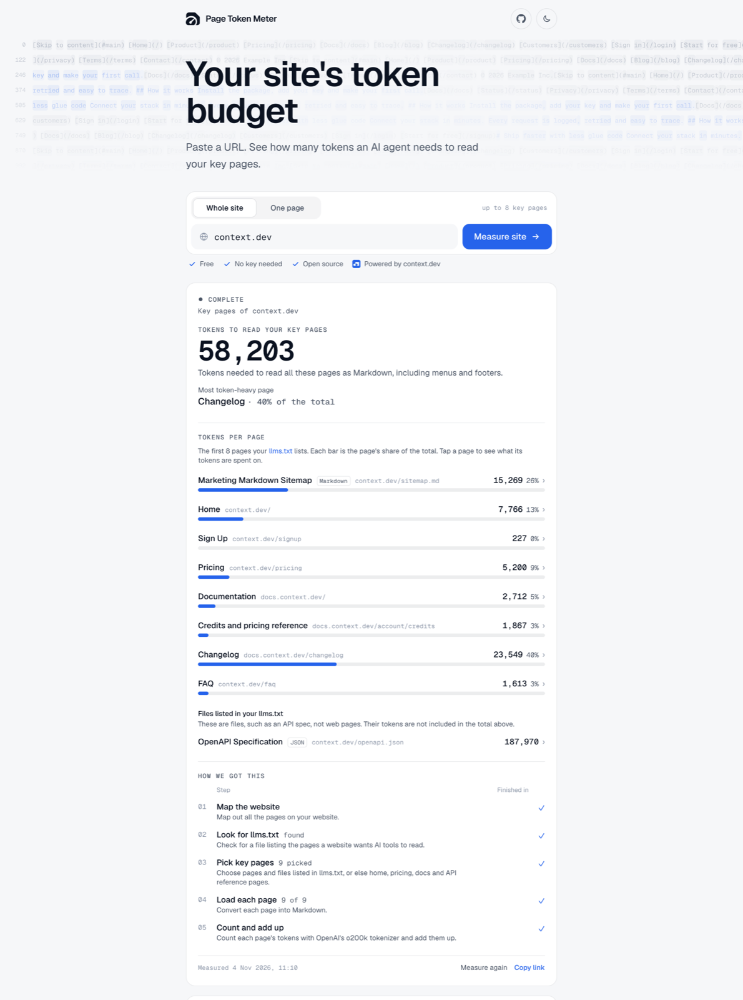

<div align="center">
  
  <h1>Page Token Meter</h1>
  <p><strong>See your website as AI agents see it.</strong> Scan a URL to see the content AI agents get from your key pages and for how many tokens.</p>
  <p>
    <a href="https://page-token-meter.vercel.app">Try it</a> ·
    <a href="#how-it-works">How it works</a> ·
    <a href="#run-locally">Run locally</a> ·
    <a href="#api">API</a>
  </p>

[](https://context.dev/?utm_source=page-token-meter&utm_medium=readme&utm_campaign=open-source)
[](LICENSE)

</div>

[](https://page-token-meter.vercel.app)

Page Token Meter shows how many tokens an AI agent needs to read your website, and how much of that is your actual content. The hosted version is free at [page-token-meter.vercel.app](https://page-token-meter.vercel.app). It is built on [context.dev](https://context.dev/?utm_source=page-token-meter&utm_medium=readme&utm_campaign=open-source), which loads each page in a real browser and turns it into Markdown.

## What it does

- **Whole website.** Measures your key pages, such as home, pricing, docs and the API reference. Shows the tokens for each page and the total.
- **One page.** Splits a page's tokens into what comes before, in and after its main content. A heatmap shows where the content sits.
- **Markdown and llms.txt.** Checks whether your website publishes an llms.txt and a Markdown version of each page.
- **Share links.** Every result gets a link with a preview image. To measure a website from the address bar, open `page-token-meter.vercel.app/your-website.com`.
- **JSON API.** Set a token budget and fail CI when a page goes over it.

## How it works

A whole-website check runs in four steps:

1. The app lists up to 500 page addresses on your website.
2. The app picks your key pages from those addresses. If your website has an llms.txt, the app also measures the files it links to, such as an OpenAPI spec.
3. Each page is loaded in a full browser with its scripts running, the way a person sees it. Then it is turned into Markdown.
4. The app counts the tokens in each page's Markdown and adds them up.

A one-page check loads the page twice: once in full and once with only its main content. Matching the two shows what comes before, in and after the main content.

- Tokens are counted with OpenAI's o200k tokenizer. The count is exact for the OpenAI models that use it, such as GPT-4o, GPT-4.1 and GPT-5.
- Other models count differently. We don't estimate their numbers.
- Pages change. Every result shows when it was measured.

## Run locally

You need Node.js 20.9 or later and a free [context.dev](https://context.dev/?utm_source=page-token-meter&utm_medium=readme&utm_campaign=open-source) API key (1,000 credits a month, no card).

```bash
git clone https://github.com/jacksonllk/page-token-meter && cd page-token-meter
cp .env.example .env   # add your CONTEXT_DEV_API_KEY
npm install && npm run dev
```

The app runs at http://localhost:3000.

## API

`/api/measure` checks one page. `/api/site` checks a whole website. Both return JSON. Set `METER_URL` to your copy's address, such as `http://localhost:3000`.

```bash
curl "$METER_URL/api/measure?url=docs.context.dev&maxTokens=3000"
```

```jsonc
{
  "measurement": {
    "url": "https://docs.context.dev/",
    "tokenizer": { "encoding": "o200k_base", "library": "js-tiktoken", "version": "1.0.21" },
    "markdown": { "tokens": 2714, "chars": 11272 },
    "mainContent": { "tokens": 1811, "chars": 7674 },
    "breakdown": { "before": 828, "main": 1809, "after": 77 },
    "published": { "status": "offered", "tokens": 2350, "url": "https://docs.context.dev/introduction.md" },
    "html": { "tokens": 166162, "chars": 473521 }
    // ...
  },
  "check": { "maxTokens": 3000, "tokens": 2714, "result": "pass" }
}
```

`maxTokens` is optional. With it, the response includes `check.result`, which is `pass` or `fail`. For `/api/site`, the budget applies to the total of all key pages:

```bash
curl "$METER_URL/api/site?domain=context.dev&maxTokens=50000"
```

To fail a CI step when a page goes over budget:

```bash
curl -s "$METER_URL/api/measure?url=docs.example.com&maxTokens=3000" | jq -e '.check.result == "pass"'
```

## Credits

Each check spends credits on your API key.

| Check | Credits |
|---|---|
| One page | 2: the full page and its main content |
| Whole website | 1 to list the addresses, plus 1 per page or file. Usually 11 or fewer with the default limit of 8 pages and 2 files. |

- The hosted site measures 8 pages per check. Your own copy can measure more with `MAX_KEY_PAGES`.
- The app downloads llms.txt files and Markdown versions straight from the website, so they use no credits. If the website blocks the download, the app gets the file through context.dev instead, for 1 credit.
- The address list holds 500 addresses at most, so it can miss a key page. When that happens, the app checks the page's usual address on the website itself, such as `/pricing` or `/docs`. That check uses no credits. If the page exists, measuring it costs 1 credit, like any other page.
- Every page is loaded fresh, so a result shows the page as it is today.
- Repeat checks within 24 hours come from the app's cache and cost nothing.

## Configuration

Copy `.env.example` to `.env`. Only `CONTEXT_DEV_API_KEY` is required.

| Variable | What it does | Default |
|---|---|---|
| `CONTEXT_DEV_API_KEY` | Your context.dev API key. | Required |
| `UPSTASH_REDIS_REST_URL`, `UPSTASH_REDIS_REST_TOKEN` | Upstash Redis for the cache, share links and credit limits. | In memory, lost on restart |
| `VISITOR_DAILY_CREDITS` | The most credits one visitor (IP address) can spend per day. | No limit |
| `DAILY_CREDIT_CAP` | The most credits the whole site can spend per day. | No limit |
| `MAX_KEY_PAGES` | The most pages a Whole website check measures. Each costs 1 credit. The app knows 15 types of key page. To add more, edit `ROLES` in `lib/keypages.ts`. | 8 |
| `LIVE_CHECKS` | Set to `off` to stop all paid API calls. Saved results are still served. | On |

## Deploy your own

Page Token Meter is a standard Next.js app. It runs on any host that supports Node.js 20.9 or later, or on your own server:

```bash
npm run build && npm start
```

1. Set `CONTEXT_DEV_API_KEY` on your host.
2. Optional: add an [Upstash Redis](https://upstash.com) database and set its two variables. Results and limits then survive restarts.
3. Before you make your copy public, set `VISITOR_DAILY_CREDITS` and `DAILY_CREDIT_CAP`. Every check spends your credits.

## Limitations

- Token counts are based on OpenAI's o200k tokenizer only.
- We find the main content inside the full page by matching it line by line, so the before, main and after split can be off by a few tokens.
- We count each page after it has fully loaded in a browser, as Markdown. Tools that fetch pages another way may get a different count.

## Contributing

See [CONTRIBUTING.md](CONTRIBUTING.md).

## License

MIT. See [LICENSE](LICENSE).
